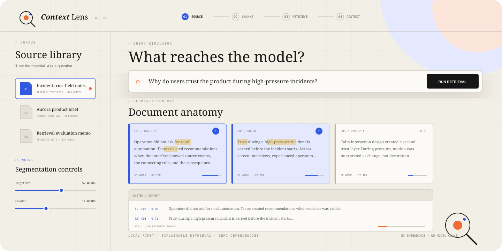
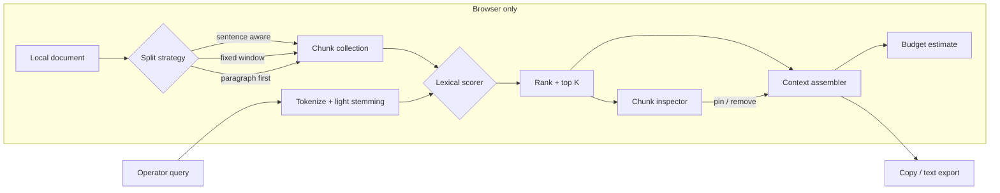

<p align="center">
  
</p>

<p align="center">
  
  
  
  
</p>

<h1 align="center">Context Lens</h1>

<p align="center">
  An inspectable RAG playground for seeing how chunk boundaries, retrieval policy,<br />
  and context budgets shape what a system is allowed to know.
</p>

> [!NOTE]
> Context Lens is a deterministic teaching **simulation**. It uses explainable lexical scoring—not embeddings, vector search, an LLM, or a remote API. Scores are useful for comparison inside the lab, not as claims of semantic similarity.

## The problem

“The model missed it” often starts earlier in the pipeline. Relevant text may be cut across chunk boundaries, outranked by repeated vocabulary, or dropped while assembling a limited context window. Those decisions tend to disappear behind a vector database call.

Context Lens makes the pipeline visible. Change one control, rerun the query, and inspect exactly which words matched, why a block ranked, and what text reached the final context.

## What you can explore

- **Three segmentation policies** — sentence-aware packing, fixed windows, and paragraph-first splitting.
- **Live chunk controls** — tune target size and overlap while watching document anatomy change.
- **Inspectable scoring** — compare query coverage, term density, and a hybrid lexical policy.
- **Top-K retrieval** — see ranked blocks, matching terms, scores, and source word offsets.
- **Manual context curation** — pin useful chunks or remove noisy ones from the assembled prompt.
- **Context budgeting** — estimate token use against a visible 1,200-token budget.
- **Local document lab** — paste your own plain text; it never leaves the browser.
- **Portable traces** — copy or export assembled context with its query, policy, and source positions.
- **Persistent setup** — custom documents, controls, theme, and last query survive refreshes.

## Pipeline architecture



Every stage lives in `app.js`. The source is split on demand, scored against the current query, ranked, and then reduced to a selected context list. The UI is a direct rendering of those intermediate values so the result stays auditable.

## Quick start

There are no packages to install and no build step.

```bash
git clone https://github.com/harshareddy0405/context-lens.git
cd 06-context-lens
python3 -m http.server 8080
```

Visit [http://localhost:8080](http://localhost:8080), or open `index.html` directly in a modern browser.

## A good first experiment

1. Keep **Incident trust field notes** selected.
2. Run: `Why do users trust the product during high-pressure incidents?`
3. Inspect the first ranked chunk and its query-coverage breakdown.
4. Reduce target size from 52 to 28 words and compare what context is lost.
5. Increase overlap; notice when repeated evidence occupies multiple top-K slots.
6. Switch the score model from **Hybrid lexical** to **Query coverage**.
7. Pin a lower-ranked block, remove a noisy block, and export the final trace.

Press `/` to focus the query field. Use `Cmd/Ctrl + Enter` to run retrieval from anywhere.

## Scoring model

The default score is deliberately small and readable:

```text
hybrid score = 0.66 × query coverage
             + 0.24 × matching-term density
             + 0.10 × exact phrase bonus
```

Common stop words are removed and a small suffix stemmer aligns forms such as “trust,” “trusted,” and “trusting.” A tiny position value resolves exact ties. This baseline is useful precisely because its limitations are visible: vocabulary mismatch is expected to fail.

## Project structure

```text
06-context-lens/
├── assets/
│   └── cover.svg       # Repository hero artwork
├── index.html          # Semantic lab interface and local-document dialogs
├── styles.css          # Responsive editorial visual system
├── app.js              # Chunking, retrieval, inspection, persistence, export
├── README.md
├── LICENSE
└── .gitignore
```

## Privacy & local-first behavior

Context Lens contains no third-party scripts, analytics, fonts, trackers, or network requests. Built-in and pasted documents are processed entirely by browser JavaScript. Custom documents and settings are stored in local storage under `context-lens-v1`; **Reset** removes custom material and restores the seeded lab. Export only occurs when you explicitly download a trace.

Avoid pasting sensitive material into any unfamiliar browser environment, even when an application is designed to be local-first.

## Accessibility

The interface uses semantic controls, visible focus states, labeled regions, keyboard-operable chunk cards, live result announcements, responsive layouts, and reduced-motion preferences. Colors are paired with labels or positions rather than used as the sole signal.

## Roadmap

- [ ] Side-by-side runs for chunking-policy comparison
- [ ] Corpus-wide retrieval across multiple documents
- [ ] Duplicate-evidence detection across overlapping chunks
- [ ] Import/export of reusable evaluation fixtures
- [ ] Precision, recall, and evidence-coverage annotation mode
- [ ] Optional adapters for user-hosted embedding and reranking services

## Contributing

Contributions are welcome, especially small retrieval experiments with clear assumptions. Keep the zero-dependency default, label simulated behavior honestly, and make intermediate scores inspectable. Test interaction changes with keyboard-only navigation and at a narrow mobile viewport.

## License

Released under the [MIT License](LICENSE).

## Built to be inspected

[](https://github.com/harshareddy0405/context-lens/actions/workflows/ci.yml)

The project includes versioned source, guarded local persistence, malformed-data recovery, product-specific interaction tests, and automated accessibility semantics checks. No API key is required to explore it.

```bash
# Optional development checks; the app itself needs no installation
npm ci --ignore-scripts
npm run check
npm test
npm run format:check
```

[Engineering notes](docs/ENGINEERING.md) · [Contributing](CONTRIBUTING.md) · [Security & privacy](SECURITY.md)

**Scope:** Retrieval is lexical—not embeddings or a vector database. The tokenizer and heuristics favor English-language text.
